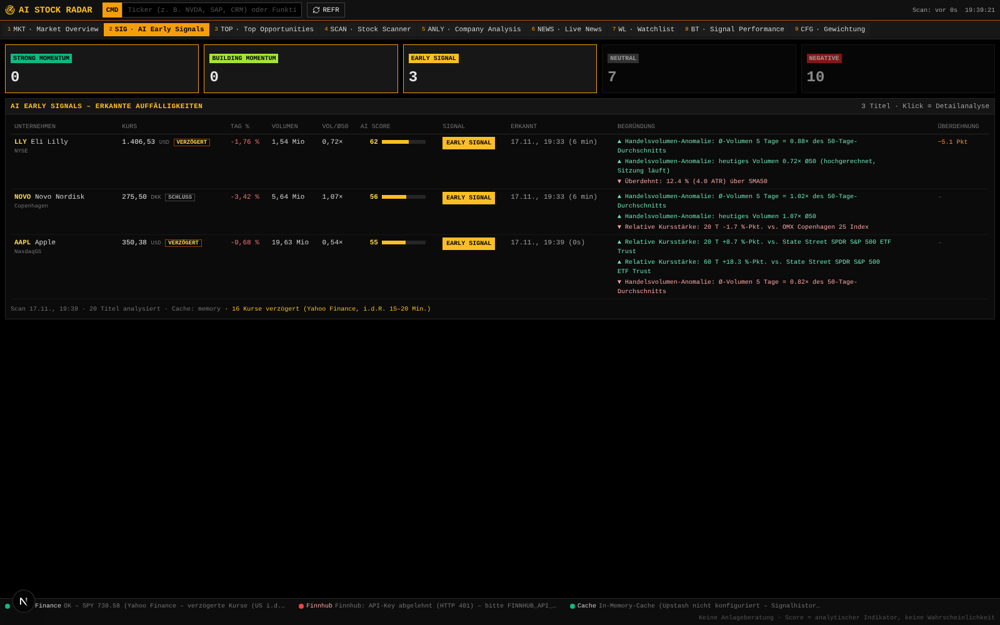

# AI STOCK RADAR

Früherkennung ungewöhnlicher Entwicklungen bei bekannten, liquiden Aktien. Die Plattform gibt jeder Aktie einen nachvollziehbaren Score von 0 bis 100 und ordnet sie in Kategorien ein. Sie arbeitet **ausschließlich mit echten Marktdaten**. Ist eine Quelle nicht erreichbar, zeigt sie einen Fehlerstatus statt Ersatzwerten.



> Der Score ist ein analytischer Indikator und **keine Wahrscheinlichkeit eines Kursanstiegs**. Keine Anlageberatung.

## Funktionen

| Taste | Code | Ansicht | Inhalt |
|---|---|---|---|
| 1 | MKT | Market Overview | US-/EU-/Asien-Indizes, Sektor-ETFs, FX/Zinsen (Kurs, Tag, 20 T, YTD, 30-T-Sparkline), Marktbreite des Universums |
| 0 | TRD | Trade-Ideen | Alle aktuellen Long- und Short-Setups mit Einstieg, Stop, Zielen und der historischen Bilanz der Regeln |
| 2 | SIG | **AI Early Signals** | Erkannte Aktien mit Kurs, Tagesveränderung, Volumen, Vol/Ø50, Score, Kategorie, Erkennungszeitpunkt, Begründung |
| 3 | TOP | Top Opportunities | Positive Signale **ohne** starke Überdehnung, Ranking = Score × (1 − Überdehnung) |
| 4 | SCAN | Stock Scanner | Sortier- und filterbar nach Score, Kategorie, Sektor, Region und Suche |
| 5 | ANLY | Company Analysis | Kurs mit SMA20/50/200 und historischen Signalen, Volumen, RSI, MACD, Kennzahlen, Earnings, Analysten, News, positive/negative Faktoren, Signalhistorie, Backtest-Signale, Erklärung |
| 6 | NEWS | Live News | Echte Unternehmensnachrichten des Universums mit transparenter Tonalität |
| 7 | WL | Watchlist | Eigene Liste (lokal im Browser), auch Titel außerhalb des Universums |
| 8 | BT | Signal Performance | Backtest über 5/10/20/60 Handelstage inklusive Fehlsignalen |
| 9 | CFG | Gewichtung | Konfigurierbare Gewichte der Engine |

Die Befehlszeile (`/`) und das Analysefeld nehmen einen Ticker (z. B. `CRM`), einen **Firmennamen** (z. B. „Fit Group“, mit Trefferliste) oder einen Funktionscode (z. B. `BT`) entgegen. Titel außerhalb des Universums werden geprüft:
- **Volle Analyse:** Ø-Handelswert mindestens 20 Mio. pro Tag und mindestens 1 Jahr Historie.
- **Eingeschränkte Analyse mit rotem Warnhinweis:** Ø-Handelswert ab 0,25 Mio. pro Tag oder ab 80 Handelstagen Historie. Nicht berechenbare Werte werden als „nicht verfügbar“ markiert.
- **Keine Analyse:** Penny Stocks (Kurs unter 5) und darunter liegende Liquidität bzw. Historie.

Jede Aktie des Universums zeigt ihre **ISIN** mit Kopier-Knopf, z. B. für die Suche bei Trade Republic.

## AI Early Signal Engine (`lib/radar/engine.ts`)

Jede Komponente liefert einen Wert von 0 bis 1 (0,5 = neutral) und dazu die konkreten Fakten, aus denen er entsteht.

| Komponente | Standardgewicht | Messgrößen |
|---|---|---|
| Handelsvolumen-Anomalie | 20 | 5-T-Volumen vs. 50-T-Ø, getrennt nach steigenden und fallenden Kursen; Akkumulations- vs. Distributionstage (Proxy für institutionelle Aktivität); Auf-/Abwärtsvolumen; OBV-Steigung |
| Relative Kursstärke | 15 | Über-/Unterrendite vs. Benchmark über 20/60 T; RS-Linie auf 60-T-Hoch **vor** dem Kurs (Frühindikator) |
| Technisches Momentum | 15 | Trendstruktur SMA50/200, SMA50-Steigung, frisches MACD-Crossover, RSI-Zone, 20/55-T-Ausbruch, Bollinger-Squeeze |
| Unternehmensnachrichten | 15 | Zeitgewichtete Tonalität (Halbwertszeit 3 T) über ein Finanzlexikon, Beschleunigung des Nachrichtenflusses |
| Fundamentale Entwicklung | 15 | Umsatz-/EPS-Wachstum, **Wachstumsbeschleunigung** (Quartal vs. TTM), Marge, Earnings-Überraschungen |
| Analystenrevisionen | 10 | Veränderung der Netto-Kaufquote über 3 Monate (65 %) und Niveau (35 %) |
| Markt & Sektor | 10 | Trend des Benchmarks und des Sektor-ETFs, Sektor relativ zum S&P 500 |

**Kombination (`lib/radar/scoring.ts`):** Der Score ist der gewichtete Mittelwert der verfügbaren Komponenten. Fehlt eine Komponente, wird ihr Gewicht auf die übrigen umverteilt; die Datenabdeckung wird angezeigt. Davon wird ein **Überdehnungsabzug** von bis zu 25 Punkten abgezogen. Er greift bei Abstand zur SMA50 in ATR-Einheiten, RSI über 70 und einer volatilitätsnormierten 60-Tage-Rendite. So wird eine bereits stark gestiegene Aktie nicht als Frühsignal bewertet.

**Kategorien:**

| Kategorie | Score | Positive Komponenten |
|---|---|---|
| STRONG MOMENTUM | ≥ 72 | ≥ 4 |
| BUILDING MOMENTUM | ≥ 63 | ≥ 3 |
| EARLY SIGNAL | ≥ 55 | ≥ 2 |
| NEGATIVE | < 42 oder überwiegend negative Komponenten | – |
| NEUTRAL | alles andere | – |

Alle Schwellen stehen in `lib/radar/config.ts`.

**Erkennungszeitpunkt:** Jeder Scan speichert Kategoriewechsel, bei konfiguriertem Upstash in Redis. „Erkannt“ ist der Zeitpunkt, an dem die aktuelle Kategorie erstmals festgestellt wurde.

**Laufende Sitzung:** Das Tagesvolumen wird über ein typisches Intraday-Volumenprofil hochgerechnet und als „hochgerechnet“ gekennzeichnet.

## Trade-Einschätzung Long / Short (`lib/radar/trade.ts`)

Jede Aktie bekommt eine regelbasierte Einschätzung: **LONG**, **SHORT**, **ABWARTEN** oder **KEIN TRADE**. Dazu gehören Einstieg, Stop-Loss, zwei Kursziele, Chance/Risiko, Überzeugungsgrad, Gründe, Gegenargumente und eine Ungültigkeitsbedingung.

| Setup | Regel |
|---|---|
| LONG | Einstufung EARLY/BUILDING/STRONG und Überdehnung < 0,6 |
| SHORT | Einstufung NEGATIVE, Kurs unter SMA50 und SMA200 (oder SMA50 < SMA200), Momentum oder relative Stärke negativ, RSI ≥ 30, nicht mehr als 5 ATR unter SMA50 |
| ABWARTEN | Setup vorhanden, aber überdehnt bzw. überverkauft: Einstieg erst bei Rücksetzer bzw. Erholung Richtung SMA20 |
| Stop / Ziele | Stop 2× ATR14, Kursziel 1 = 1,5R, Kursziel 2 = 3R, maximale Haltedauer 20 Handelstage |

Der Backtest (Ansicht BT, Richtung Long oder Short) simuliert **exakt diese Regeln** mit Stop-Loss, Kursziel, Zeitausstieg, Kurslücken und Kosten. Die historische Bilanz der Regeln steht direkt in jeder Trade-Box. Das ist eine analytische Einordnung, keine Anlageberatung.

## Historische Validierung (`lib/radar/backtest.ts`)

- **Walk-forward, point-in-time:** Alle Indikatoren sind kausal. Ein Unit-Test belegt, dass Signale an Tag t mit und ohne Zukunftsdaten identisch sind.
- Einstieg zum **Eröffnungskurs des Folgetags** (Verzögerung konfigurierbar), Ausstieg nach 5/10/20/60 Handelstagen.
- **Transaktionskosten** je Seite konfigurierbar (Standard 10 bp).
- Vergleich mit dem **Benchmark** und mit einer **Baseline**: Einstieg an jedem beliebigen Tag in denselben Titeln.
- Alle Einzelsignale werden gezeigt, inklusive Fehlsignalen und maximalem Zwischenverlust.
- Nachrichten, Fundamentaldaten und Analystenrevisionen sind mit freien Daten nicht point-in-time verfügbar. Sie fließen deshalb **nicht** in den Backtest ein, statt sie mit heutigen Werten zu füllen (das wäre Look-ahead Bias).
- **Survivorship- und Selektionsbias** werden in der App ausdrücklich ausgewiesen: Das Universum besteht aus heute bekannten Gewinnern.

## Datenquellen und API-Keys

| Quelle | Key | Kosten | Liefert | Ohne Key |
|---|---|---|---|---|
| Yahoo Finance (Chart/Search) | nein | kostenlos | Kurse (verzögert), adjustierte OHLCV-Historie bis 10 J., Indizes, ETFs, FX, Nachrichten | – |
| Finnhub (Free Tier) | `FINNHUB_API_KEY` | kostenlos ([registrieren](https://finnhub.io/register)) | Analystenempfehlungen, Kennzahlen, Earnings-Überraschungen und -Kalender, Company News, US-Echtzeitkurs | Komponenten Fundamentaldaten und Analysten „nicht verfügbar“ |
| Upstash Redis | `UPSTASH_REDIS_REST_URL/TOKEN` | kostenloser Plan reicht | geteilter Cache, persistente Signalhistorie | In-Memory-Cache |

**Nur mit kostenpflichtigen Datenpaketen möglich (nicht implementiert, keine Ersatzwerte):**
- echte institutionelle Positionen (13F / Ownership)
- Upgrade/Downgrade-Historie und Kursziele
- EPS-Schätzungsrevisionen
- Fundamentaldaten für Nicht-US-Listings ohne ADR (z. B. Siemens)
- Echtzeitkurse für europäische Börsen

**Kennzeichnung der Datenfrische:** Jeder Kurs trägt ein Label: `ECHTZEIT` (Finnhub, US), `VERZÖGERT` (Yahoo während der Handelszeit) oder `SCHLUSS`. Dazu werden Quelle und Zeitpunkt des letzten Kurses angezeigt.

**Caching** (`lib/radar/cache.ts`): Kurse 5 Min., News 15 Min., Analysten 12 h, Kennzahlen/Earnings 24 h, Scan 4 Min., Backtest 6 h. Gleichzeitige Anfragen an denselben Schlüssel werden zusammengefasst. Rate-Limiter: Yahoo 100/min, Finnhub 55/min. Ein Circuit-Breaker bricht bei 401/429 sofort ab, statt Anfragen aufzustauen. Fehler werden nie gecacht.

## Installation

```bash
pnpm install
cp .env.example .env.local   # FINNHUB_API_KEY eintragen (empfohlen), optional Upstash
pnpm dev                     # http://localhost:3000
pnpm test                    # Unit-Tests (Look-ahead, Scoring, Sentiment)
pnpm typecheck && pnpm lint
pnpm build && pnpm start
```

Der erste Scan lädt alle Daten (einige Sekunden; mit Finnhub beim Kaltstart bis etwa 1,5 Min. wegen 60 Aufrufen/Min.). Danach greift der Cache. Auf Vercel ist für `/api/radar/scan` und `/api/radar/backtest` eine `maxDuration` von bis zu 300 s gesetzt.

**Universum erweitern:** einen Eintrag in `lib/radar/universe.ts` ergänzen oder `RADAR_EXTRA_UNIVERSE` setzen (siehe `.env.example`).

## Architektur

```
app/api/radar/        scan · stock/[ticker] · overview · news · backtest · status · universe
lib/radar/
  providers/          yahoo.ts · finnhub.ts · http.ts (Rate-Limiter, Fehler)
  cache.ts            Upstash Redis / In-Memory, In-Flight-Dedupe, Signalhistorie
  indicators.ts       kausale Indikatoren (SMA, EMA, RSI, MACD, ATR, OBV, Bollinger)
  engine.ts           7 Score-Komponenten + Überdehnung
  scoring.ts          Kombination, Kategorien, Begründung (auch clientseitig für eigene Gewichte)
  sentiment.ts        transparentes Finanz-Sentiment-Lexikon
  analyze.ts · scan.ts · backtest.ts
components/radar/     Terminal-UI (React Query, Jotai, Recharts, Tailwind, shadcn)
```

Alle simulierten Datenquellen der ursprünglichen Bloomberg-Terminal-Demo wurden entfernt: zufällige Kurse, Fallback-Daten, clientseitige Kurssimulation und zufällige Sparklines.

## Lizenz

MIT
